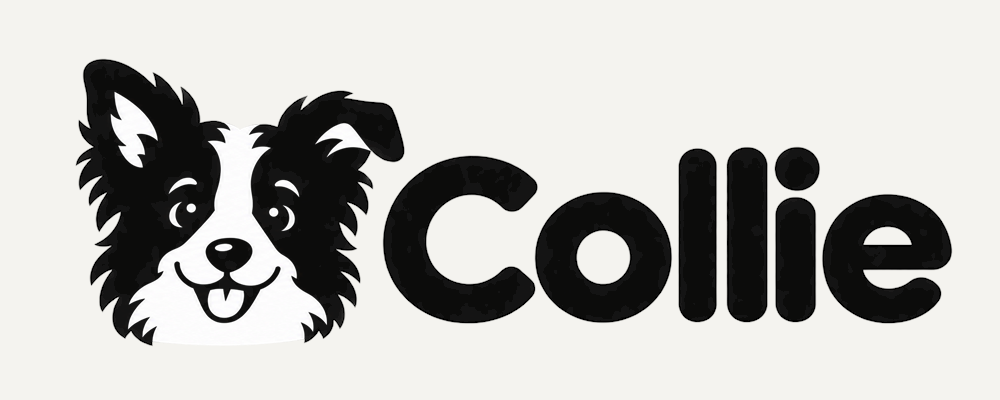

<p align="center">
  <a href="https://colliesr.com"></a>
</p>

<h3 align="center">Collie agent kit</h3>

<p align="center">
  Connect your own AI agent to Collie, the systematic review and meta-analysis workbench.<br>
  <strong>AI suggests. You decide.</strong>
</p>

<p align="center">
  
  
  
</p>

<p align="center">
  <a href="https://app.colliesr.com">Open Collie</a> ·
  <a href="docs/install-claude-code.md">Claude Code</a> ·
  <a href="docs/install-manual.md">Other clients</a> ·
  <a href="docs/troubleshooting.md">Troubleshooting</a> ·
  <a href="docs/security.md">Security</a> ·
  <a href="docs/developers/README.md">Developers</a>
</p>

---

## What it is

[Collie](https://colliesr.com) is a workbench for systematic reviews and meta-analyses: protocol, search, deduplication, screening, data extraction, risk of bias, meta-analysis, GRADE and PRISMA, in one place. This kit connects the AI agent you already use to your Collie account over the Model Context Protocol (MCP). The AI runs on your own AI subscription, not on Collie. Your agent works through the same tools you see in the app: it writes suggestions and drafts, and you accept or dismiss them in Collie.

## Requirements

- A Collie account. Every plan can connect an agent, Free included. [Sign up](https://app.colliesr.com).
- [Node.js](https://nodejs.org) 20 or newer.
- An MCP client: Claude Code, Claude Desktop, Codex, Gemini CLI, Cursor, Perplexity (Mac app) or any client that runs stdio MCP servers.

## Install in Claude Code (recommended)

Claude Code gets the full kit: the MCP server, skills, subagents, hooks and the live Collie pane.

```text
/plugin marketplace add leandromedeirosfelix/collie-agent-kit
/plugin install collie@collie-agent-kit
```

1. Restart Claude Code.
2. Ask: *"Connect to Collie."* The agent shows a link and a short code.
3. Open [app.colliesr.com/connect](https://app.colliesr.com/connect), sign in and **type the code** to approve the agent. A link alone never approves it.
4. Type `/collie` to open the Collie pane.

Details: [docs/install-claude-code.md](docs/install-claude-code.md).

## Manual install (other MCP clients)

The server runs with `npx -y github:leandromedeirosfelix/collie-agent-kit`. Add it to your client's config, restart the client, then ask the agent to connect to Collie.

<details>
<summary><strong>Claude Desktop</strong></summary>

Settings › Developer › Edit Config opens `claude_desktop_config.json`:

- macOS: `~/Library/Application Support/Claude/claude_desktop_config.json`
- Windows: `%APPDATA%\Claude\claude_desktop_config.json`

```json
{
  "mcpServers": {
    "collie": {
      "command": "npx",
      "args": ["-y", "github:leandromedeirosfelix/collie-agent-kit"]
    }
  }
}
```

Quit Claude Desktop completely and open it again.
</details>

<details>
<summary><strong>Codex</strong></summary>

`~/.codex/config.toml` (shared by the Codex CLI, app and IDE extension):

```toml
[mcp_servers.collie]
command = "npx"
args = ["-y", "github:leandromedeirosfelix/collie-agent-kit"]
startup_timeout_sec = 60
tool_timeout_sec = 300
```

Or: `codex mcp add collie -- npx -y github:leandromedeirosfelix/collie-agent-kit`. The longer timeouts cover the first download and analyses that take a few minutes.
</details>

<details>
<summary><strong>Gemini CLI</strong></summary>

`~/.gemini/settings.json` (or `.gemini/settings.json` in a project):

```json
{
  "mcpServers": {
    "collie": {
      "command": "npx",
      "args": ["-y", "github:leandromedeirosfelix/collie-agent-kit"]
    }
  }
}
```
</details>

<details>
<summary><strong>Cursor</strong></summary>

`~/.cursor/mcp.json` (all projects) or `.cursor/mcp.json` (one project):

```json
{
  "mcpServers": {
    "collie": {
      "type": "stdio",
      "command": "npx",
      "args": ["-y", "github:leandromedeirosfelix/collie-agent-kit"]
    }
  }
}
```
</details>

<details>
<summary><strong>Perplexity (Mac app)</strong></summary>

Perplexity runs local MCP servers in its Mac app only.

1. Open **Plugins** and install the helper app **PerplexityXPC**.
2. **Plugins › Add custom › Simple**: server name `collie`, command `npx -y github:leandromedeirosfelix/collie-agent-kit`.
3. Wait until the connector shows *Running*, then turn on `collie` under **Sources**.
</details>

<details>
<summary><strong>Any other stdio MCP client</strong></summary>

| Field | Value |
|---|---|
| Command | `npx` |
| Arguments | `-y` `github:leandromedeirosfelix/collie-agent-kit` |
| Transport | stdio |
| Environment | optional, see below |
</details>

**Windows:** if your client cannot start `npx` directly, use `"command": "cmd"` and `"args": ["/c", "npx", "-y", "github:leandromedeirosfelix/collie-agent-kit"]`.

**Optional environment variables**

| Variable | Default | Use |
|---|---|---|
| `MSR_TOKEN` | none | A personal access token from Collie › Settings › AI agents (MCP). Replaces the code sign-in. |
| `MSR_URL` | `https://app.colliesr.com` | The Collie address. Leave it unset. |

All clients, step by step: [docs/install-manual.md](docs/install-manual.md).

## What you get

| Part | What it does | Where |
|---|---|---|
| MCP server | Collie's tools for your agent: reviews, protocol, search, duplicates, screening, full text, extraction, risk of bias, analysis, GRADE, PRISMA | Every client |
| 13 skills | One per stage of a review, plus help. Start with `collie-workflow` | Claude Code |
| 8 subagents | Methodologist, search strategist, screener, extractor, risk-of-bias assessor, biostatistician, manuscript writer, peer reviewer | Claude Code |
| Live pane | `/collie`: connection, the active review's stages with progress bars, AI suggestions waiting for you, your agent's recent Collie calls. The status line shows the review and screening progress | Claude Code |
| Guardrail hooks | Ask you before the agent casts a real screening vote or installs R packages; check the syntax of `.R` files it edits; report the Collie connection at session start | Claude Code |

Skills and subagents are short stubs. Each one asks Collie for its full instructions with the `collie_guide` tool, which answers only for a signed-in account.

## Using it

Ask in plain words, for example:

- *"Where is my review and what's next?"*
- *"Is a meta-analysis on early mobilisation after hip fracture surgery viable?"*
- *"Pre-screen the next 50 records against my criteria."*
- *"Extract the outcome data for the included studies."*
- *"Draft the risk-of-bias assessments for the included trials."*

The agent writes suggestions and drafts. You accept, edit or dismiss them in Collie. A screening vote by the agent is a real reviewer vote, so Claude Code asks you first.

## Privacy and security

- The kit talks only to `app.colliesr.com` (or your `MSR_URL`), with your token. Nothing else is sent anywhere.
- Your AI client sends what the agent reads to your AI provider, under your agreement with that provider.
- The token is stored on your computer: `%APPDATA%\collie\token.json` on Windows, `~/.config/collie/token.json` on macOS and Linux (readable by your user only on macOS and Linux).
- Disconnect this computer: ask the agent to run `collie_disconnect`. Revoke the token itself: Collie › Settings › AI agents (MCP).
- No token can delete anything in Collie.
- The kit contains no review method. Collie serves its guides to signed-in users.

More: [docs/security.md](docs/security.md).

## Updating

- Claude Code: `/plugin marketplace update collie-agent-kit`, then restart Claude Code.
- Other clients: `npx` fetches the kit from GitHub when the client starts the server. Restart the client. If an older version keeps running, see [troubleshooting](docs/troubleshooting.md#an-old-version-keeps-running).

## Uninstall

- Claude Code: `/plugin uninstall collie@collie-agent-kit`, then `/plugin marketplace remove collie-agent-kit`.
- Other clients: remove the `collie` entry from the client's config.
- Then delete the token file above (or run `collie_disconnect` first) and revoke the token in Collie › Settings › AI agents (MCP).

## Troubleshooting

| Problem | What to do |
|---|---|
| "Not connected to Collie" | Ask the agent to connect, then type the code at app.colliesr.com/connect. |
| The code expired, or the token was revoked | Ask the agent to run `collie_connect` again. |
| `npx` not found | Install Node.js 20+, restart the client. On Windows, try `cmd /c npx`. |
| Behind a corporate proxy | See [troubleshooting](docs/troubleshooting.md#corporate-proxy). |

Full list: [docs/troubleshooting.md](docs/troubleshooting.md).

## For developers

The [developer documentation](docs/developers/README.md) covers how the kit works and how to build on it:

- [Architecture](docs/developers/architecture.md): the server, the plugin layers, what runs where, and the human-in-the-loop guarantees.
- [Authentication](docs/developers/authentication.md): the code sign-in, tokens, scopes and revoking.
- [Tools reference](docs/developers/tools-reference.md): every MCP tool with its parameters, generated from the server.
- [Skills and subagents](docs/developers/skills-and-agents.md), [hooks and the Collie pane](docs/developers/hooks-and-pane.md).
- [Integrating other clients](docs/developers/integrating-other-clients.md): any stdio MCP client, or your own TypeScript or Python code.
- [Versioning](docs/developers/versioning.md).

Contributions are welcome: see [CONTRIBUTING.md](CONTRIBUTING.md). Report vulnerabilities privately as [SECURITY.md](SECURITY.md) describes.

## Support

Write to [contact@colliesr.com](mailto:contact@colliesr.com).

## License

The agent kit is open source under the [MIT License](LICENSE). Copyright (c) 2026 CollieSR Company. Open-source components in the server bundle: [THIRD-PARTY-NOTICES.md](THIRD-PARTY-NOTICES.md).

The Collie service ([app.colliesr.com](https://app.colliesr.com)) and the method guides it serves through `collie_guide` are not part of the kit. They are governed by Collie's [Terms of Use](https://colliesr.com/terms.html).
