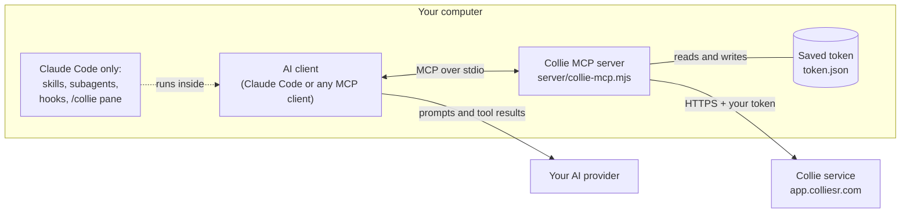

# Architecture

The kit connects an AI agent that runs on your computer to your Collie account. The agent's model runs on your own AI subscription. Collie stores the reviews, runs the statistics and keeps the audit log.

## Overview

1. Your AI client starts the Collie MCP server as a child process and talks to it over stdio.
2. When the agent calls a tool, the server sends one or more HTTPS requests to Collie with your token and returns Collie's answer as the tool result.
3. The client sends what the agent reads and writes to your AI provider, under your agreement with that provider. The kit itself sends nothing there.

## The MCP server

| Property | Value |
|---|---|
| File | `server/collie-mcp.mjs`, a single bundled ES module |
| Runtime | Node.js 20 or newer |
| Dependencies to install | None. The open-source packages it includes are listed in [THIRD-PARTY-NOTICES.md](../../THIRD-PARTY-NOTICES.md). |
| Transport | stdio (one JSON-RPC message per line) |
| Server name | `collie` |
| Remote | `https://app.colliesr.com`, or `MSR_URL` |
| Started by | `npx -y github:leandromedeirosfelix/collie-agent-kit` (any client), or `node ${CLAUDE_PLUGIN_ROOT}/server/collie-mcp.mjs` (the plugin's [`.mcp.json`](../../.mcp.json)) |

The server is generated from Collie's private source and published here as a build artifact. It is stateless apart from the saved token: every tool call is a request to Collie, so what the agent sees is always Collie's current data.

Behaviour you can rely on:

- **Instructions.** The server's MCP `instructions` tell the agent how to connect, to load `collie_guide` before review work, and Collie's hard rules (see [Human in the loop](#human-in-the-loop)).
- **Annotations.** Every tool declares MCP annotations (`readOnlyHint`, `destructiveHint`, `idempotentHint`, `openWorldHint`). The [tools reference](tools-reference.md) shows them as read or write.
- **Errors.** A failed call returns an MCP error result whose text says what happened and what to do next, for example `token_read_only`, `token_cannot_delete` or `rate_limited`. When the connection fails during a write, the error says the change may not have been saved and asks the agent to read it back before retrying.
- **Timeouts.** The server waits up to 4 minutes for Collie, long enough for an R analysis. Raise your client's tool timeout to match.
- **Rate limits.** If Collie asks a read to wait 5 seconds or less, the server waits and retries once. Otherwise it returns the error with the wait time.

## The Claude Code plugin

In Claude Code the same server is wrapped in a plugin. The layers:

| Layer | Files | What it adds |
|---|---|---|
| Manifest | `.claude-plugin/plugin.json`, `.claude-plugin/marketplace.json` | Plugin metadata and the marketplace entry used by `/plugin install`. |
| MCP server | `.mcp.json`, `server/` | Starts the bundled server with `MSR_URL` and `MSR_TOKEN` from your environment. Tools appear as `mcp__plugin_collie_collie__<tool>`. |
| Skills | `skills/*/SKILL.md` | 13 short stubs. Each tells the agent to fetch its full guide with `collie_guide`. |
| Subagents | `agents/*.md` | 8 stubs with a model and an allow-list of Collie tools. Each fetches its guide with `collie_guide`. |
| Command hooks | `hooks/hooks.json`, `hooks/*.mjs` | Session check, a guard before real screening votes, a guard before R package installs, and an R syntax check. |
| Pane module | `hooks/live/`, `types/index.d.ts` | The `/collie` pane and the status line. It watches the agent's Collie calls and reads review counts. |

Details: [Skills and subagents](skills-and-agents.md), [Hooks and the Collie pane](hooks-and-pane.md).

Other clients get the MCP server only. They still receive the server's instructions and can load every guide with `collie_guide`.

## What runs where

| On your computer | On Collie |
|---|---|
| The MCP server process and the saved token | Your reviews, records, decisions, extracted data and assessments |
| The plugin's hooks and pane (Claude Code) | Permission checks for your token and your role in each review |
| Local R, only for the optional `.R` syntax check | Meta-analyses and figures in R (`outcome_analyze`, `analysis_run`, `rob_plots`) |
| Your AI client, which talks to your AI provider | Searches of external databases (PubMed, OpenAlex and others) for the search and explore tools |
| | The method guides served by `collie_guide` and the help center served by `help_search` |
| | The audit log of every change, marked as made by a human or by an AI token |

The kit opens network connections to your Collie address only. The session-check hook makes one request to the same address at session start. Apart from `npx` downloading the kit from GitHub, nothing is sent to any other host, and the kit collects no analytics.

## Human in the loop

Collie's rule is **AI suggests, humans decide**. The kit and the service enforce it in layers:

| Guarantee | Where it is enforced |
|---|---|
| No token can delete anything. | Collie. Deleting is done by a person in the web app (`token_cannot_delete`). |
| A connection needs a person to type a code in Collie. A link alone never approves an agent. | Collie, during [`collie_connect`](authentication.md#connect-with-a-code). |
| Screening suggestions, extraction answers, duplicate verdicts and risk-of-bias assessments are saved as suggestions or drafts that a person accepts, edits or dismisses. | Collie, through the tools `ai_suggest`, `ai_extraction_put`, `duplicates_suggest` and `rob_assess`. |
| A screening vote by an agent (`screening_decide`) is a real reviewer vote, so Claude Code asks you before each one. | The `human-decides` hook (Claude Code). Other clients show their own tool approval. |
| Outcome data can only fill empty cells. A person changes saved values in Collie. | Collie, in `outcome_data_put`. |
| A GRADE judgement can only be saved for an outcome that has none yet (`grade_exists`). | Collie, in `grade_set`. |
| The screening queue stays empty until duplicates are resolved and the review has inclusion criteria. | The MCP server, in `screening_queue`, from Collie's `ai_status`. |
| Collie never submits a protocol to PROSPERO. The review team registers it. | Collie, in `protocol_set`. |
| Every change an agent makes is recorded with the actor `ai`. | Collie's audit log (`audit_log`). |
| Statistics run in Collie's R engine, never by hand, with the method chosen a priori. | The server's instructions and Collie's guides. |

The server's instructions also tell the agent never to invent or impute numbers, to choose "maybe" when in doubt during screening, and never to install R packages silently.
