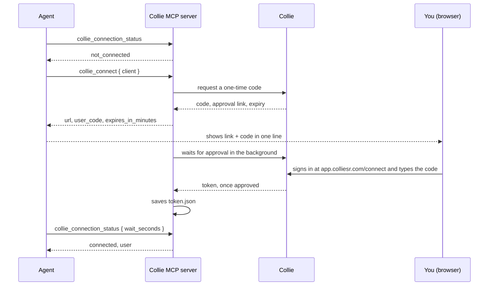

# Authentication

Every tool call reaches Collie with a bearer token that belongs to one Collie account. The server gets that token in one of two ways:

| Method | How | Best for |
|---|---|---|
| Code sign-in | The agent calls `collie_connect`; you type a short code in Collie. The server saves the token on your computer. | People using an AI client. No token to copy. |
| Personal access token | You create a token in Collie and set `MSR_TOKEN` in the server's environment. | Scripts, CI, a separate reviewer account, or a token you manage yourself. |

When both exist, `MSR_TOKEN` wins.

## Connect with a code

The code sign-in works like a device code flow: the agent starts it, and a person approves it in a browser where they are already signed in.



1. **Check first.** The agent calls `collie_connection_status`. If the answer is `connected`, there is nothing to do.
2. **Start.** Only when you want to work in Collie, the agent calls `collie_connect`. The optional `client` parameter (up to 60 characters, for example `"Codex"`) is the name Collie shows on the approval page. The server tries to open the approval page in your browser and returns:

   | Field | Meaning |
   |---|---|
   | `state` | `pending` |
   | `url` | The approval page, [app.colliesr.com/connect](https://app.colliesr.com/connect) with the code |
   | `user_code` | The code you type |
   | `browser_opened` | Whether the server could open the browser |
   | `expires_in_minutes` | How long the code is valid |
   | `message` | A one-line instruction for the agent to show you |

3. **Approve.** You sign in to Collie and **type the code** shown by the agent. Opening the link is not enough: the code must come from your own screen, so a link sent by someone else cannot connect their agent to your account.
4. **Wait.** The server waits for the approval in the background. The agent calls `collie_connection_status` with `wait_seconds` (0 to 120) to wait for the result instead of polling quickly.
5. **Done.** On approval the server saves the token, and every Collie tool works. Other sessions on the same computer use the saved token.

`collie_connection_status` answers one of these states:

| Answer | Meaning | Next step |
|---|---|---|
| `connected: true`, `user`, `email`, `via` | Connected. `via` is `MSR_TOKEN` or `saved connection`. | None |
| `pending` | Waiting for you to type the code. | Type the code, or wait with `wait_seconds`. |
| `expired` | The code expired. | Call `collie_connect` again. |
| `denied` | The approval was denied. | Call `collie_connect` again if you still want to connect. |
| `error` | The sign-in failed; `message` says why. | Call `collie_connect` again. |
| `not_connected` | No token. | Call `collie_connect` when you want to use Collie. |
| `unreachable` | A token exists but Collie did not answer. | Check the network or `MSR_URL`. |

Calling `collie_connect` while already connected returns the connection with `Already connected.` Calling it while a code is pending returns the same code.

## Where the token is saved

| OS | Path |
|---|---|
| Windows | `%APPDATA%\collie\token.json` |
| macOS and Linux | `$XDG_CONFIG_HOME/collie/token.json`, by default `~/.config/collie/token.json` |
| Any | `COLLIE_TOKEN_FILE`, if set |

- On macOS and Linux the file is readable and writable by your user only (mode `0600`).
- The file records the Collie address the token was issued by. The server ignores a saved token from a different address, so a token for one `MSR_URL` is never sent to another.
- The Claude Code session-check hook reads the same file to report the connection at session start. It never prints the token.

## Personal access tokens

Create a token in Collie › **Settings › AI agents (MCP)**, then pass it to the server as `MSR_TOKEN`:

```json
{
  "mcpServers": {
    "collie": {
      "command": "npx",
      "args": ["-y", "github:leandromedeirosfelix/collie-agent-kit"],
      "env": { "MSR_TOKEN": "<your token>" }
    }
  }
}
```

In the Claude Code plugin, set `MSR_TOKEN` in the environment Claude Code starts from; the plugin's `.mcp.json` passes it through.

- `MSR_TOKEN` wins over a saved connection.
- Keep it out of shared or committed configuration files, and never paste it into a chat, an issue or an email.
- If Collie rejects an `MSR_TOKEN` (revoked or expired), the server keeps using it and every call fails. Create a new token, or remove the variable and use the code sign-in.

## Token scopes

| Token | Can do |
|---|---|
| Code sign-in (`collie_connect`) | Read and write |
| Personal access token, read | Read only |
| Personal access token, write | Read and write |

- A read token gets `token_read_only` on any write. That includes tools that only read but send a query to Collie, such as `search_count`, `explore_search` and `ask_data`.
- **No token can delete anything** (`token_cannot_delete`). Deleting is done by a person in the web app.
- A token acts with its account's role in each review. Owner-only actions, such as `criteria_set`, need an owner's token.
- Collie records every change made with a token in the review's audit log with the actor `ai`.

`collie_setup` returns the same scope summary, with install snippets for each client.

## Choosing the Collie address

`MSR_URL` sets the Collie address, by default `https://app.colliesr.com`. Leave it unset unless Collie support tells you otherwise. The saved token is tied to the address, so changing `MSR_URL` means connecting again.

## Disconnect and revoke

| Goal | How |
|---|---|
| Forget the connection on this computer | Call `collie_disconnect`, or delete `token.json`. If `MSR_TOKEN` is set, it stays in use until you remove it. |
| Stop the token working everywhere | Revoke it in Collie › Settings › AI agents (MCP). |

After a revocation, the next call with a saved token fails; the server deletes the saved token and answers `The saved Collie connection is no longer valid`. The agent can then call `collie_connect` again.

## Errors you may see

| Error | Meaning |
|---|---|
| `Not connected to Collie yet` | No token. Connect with `collie_connect`. |
| `The saved Collie connection is no longer valid` | The saved token was revoked or expired, and the server removed it. |
| `token_read_only` | A read token tried to write. |
| `token_cannot_delete` | Expected: no token can delete. |
| `rate_limited` | Collie asked the agent to slow down. The error gives the wait in seconds. |
| `CONNECTION WARNING` | Collie did not answer. For a write, the change may not have been saved: read it back before retrying. |

More fixes: [troubleshooting](../troubleshooting.md). Security model: [docs/security.md](../security.md).
